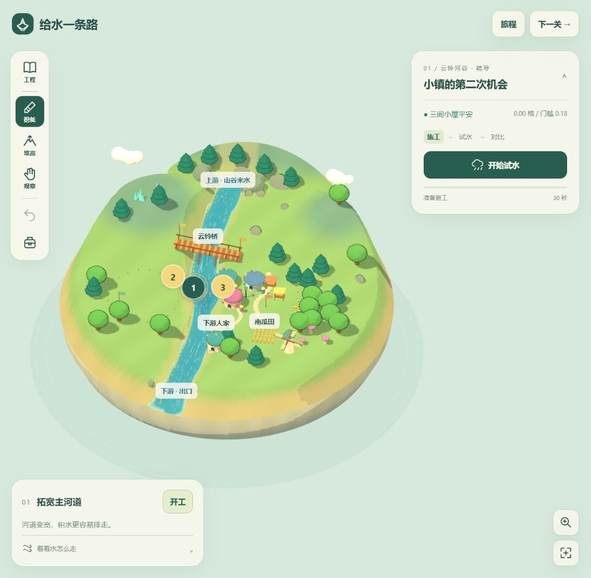
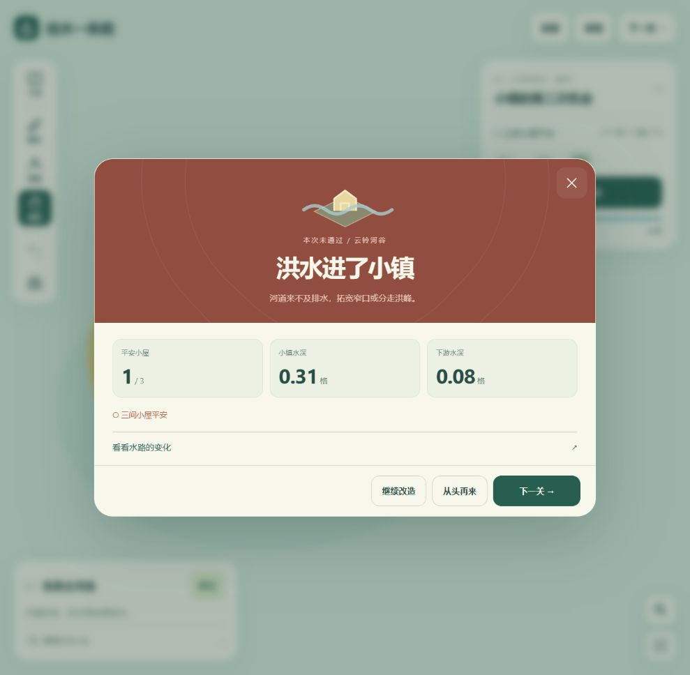

# Water Isle Simulation · Give Water a Way

[简体中文](README.md) | **English**

[Download the game HTML](https://raw.githubusercontent.com/404-NOT-FOUND-ERROR/Water-Isle-Simulation/main/index.html) · [MIT License](LICENSE)

An interactive water-engineering sandbox on floating islands. Shape the terrain, guide a construction crew, and see how a river responds to channels, bridges, dams, and changing weather. Five progressive challenges combine flood protection with water storage and irrigation, followed by a free-building island.

The game interface is in Simplified Chinese. Documentation is available in Chinese and English. Floating tools, contextual diagrams, live gates, and independent comparisons guide the campaign. The island surface and layered underside share one continuous circular shoreline.



## Play

Download the repository and open **`index.html`** in a modern browser with WebGL enabled. The roughly 3.1 MB file includes Three.js, procedural models, game code, and initial river states. Gameplay and local saves work offline; further-reading links use the internet.

You can also serve this directory locally:

```sh
python -m http.server 8080
```

Then visit `http://localhost:8080/`. Add `?level=1` through `?level=6` to open an island directly.

## Controls and engineering

- **Press and hold to build.** Summon the crew to a reachable position and keep digging or filling while held. Drag to change the work site; release to stop. One continuous gesture is one undo step.
- **Choose a yellow marker or the left project menu.** The menu shows every project, prerequisites, and progress at every screen size. Start the highlighted plan; stop to keep partial changes. Completed projects offer the next step or a storm test.
- **Manage soil and work hours.** Excavation adds soil to storage; filling and dam construction consume it. Traveling 20 distance units or moving 18 volume units of earth costs one work hour. Each crew challenge has its own budget.
- **Inspect the island.** The observation tool supports dragging or arrow keys to rotate. Use the mouse wheel or zoom button to move closer, and the overview button to return to the whole island.
- **Test a storm.** Watch water levels, flow traces, bridge condition, and the objective checklist. The last challenge continues from rain into a dry spell.
- **Operate the gate.** A persistent left-side gate button opens five clearly labeled settings: closed, 25%, half, 75%, and fully open. Left/right keys change settings. Before construction, the panel links to soil collection and dam building. The live cross-section and island gate animate together, showing storage, discharge, and overtopping. Pause to adjust, then resume. Fast-forward to the dry phase or the result using the complete simulation; return to construction at any time while keeping your work.
- **Follow contextual diagrams.** Guidance changes after borrowing soil, building the dam, connecting an outlet, and entering the dry season. The lower-left floating hint expands into the same diagrams on every screen size. The gate panel opens after dam completion, when a trial starts, and when rain gives way to dry weather.
- **Improve your result.** Earn stars for meeting objectives, conserving resources, and retaining a safety margin. Distinct success and failure panels highlight the outcome and key measurements. Both offer another attempt, a fresh start, and the next island. Best scores save automatically; construction undo remains available after a trial.
- **Save your island.** Terrain, water, momentum, resources, engineering structures, gate settings, and campaign progress are stored in the browser.

## Six distinct islands

| Island | Main challenge | Engineering choices | Starting resources |
| --- | --- | --- | --- |
| Cloudbell Valley | Protect three homes beside a narrow river | Widen the channel, divert water, build a bank | Free terrain editing |
| Bluestone Gorge | Protect an inn settlement and a bridge in a fast current | Excavate a bypass, widen the bridge channel, reinforce a bank | 65 work hours; 20 soil units |
| Twin-Branch Isle | Keep settlements on both river branches safe | Clear the eastern inlet and outlet, widen the western branch | 68 work hours; no stored soil |
| Crescent Lake | Build a dam, store at least 700 water units, protect downstream homes | Excavate a borrow pit, build a gated dam, clear the discharge channel | 55 work hours; 10 soil units |
| Windmill Plain | Coordinate flood protection, bridge safety, irrigation, and reserves | Borrow soil, build a dam, improve discharge, connect irrigation and drainage channels | 70 work hours; 10 soil units |
| Star Isle | Experiment in a winding river valley | Excavate lakes, reshape rivers, change the weather | Free terrain editing |

Windmill Plain combines six objectives: protect the town, keep the bridge open, protect downstream homes, reach 500 water units in storage, supply shallow irrigation during the dry spell, and finish with at least 100 water units remaining. Irrigation requires 24 cumulative simulated seconds; field depth must stay below 0.50 units throughout the test. Crops consume water during the dry spell, so a stagnant puddle cannot earn unlimited irrigation time. Tests run at four times simulation speed.




## Compare and learn

Each trial also runs an untouched reference island with the same inflow and time steps. Expand the result to see water depth and flow at peak inflow, marks homes that flooded at any time, and explains the completed projects and gate changes. Water-level histories and the detailed metric table are folded below the maps. There is no prediction quiz.

The [design notes](DESIGN.md) document progression, star criteria, tested alternatives, and mechanism references from Timberborn and Terra Nil. A bypass and a wider bridge channel can each solve the bridge challenge; opening a distributary inlet without an outlet can flood the other bank. In the final challenge, gate operation responds to the change from rain to dry weather.

## Water simulation and visible consequences

The river uses a two-dimensional shallow-water solver on an **81 × 81 grid**. It tracks water depth and depth-integrated momentum in both directions. HLL finite-volume fluxes, hydrostatic reconstruction, Manning friction, and adaptive CFL time steps govern movement. Water enters through the headwaters and leaves at the island boundary; terrain editing preserves water volume.

White flow traces follow the computed velocity field and retain their position history. Each map has its own riverbed, inlet direction, branches, storage basin, settlements, and farmland.

Bridges use a game-scale scour durability model. Local depth and velocity determine an exposure measure proportional to depth × velocity²; exposure above a bridge's resistance accumulates damage over time. The bridge changes color and shakes as durability falls, then loses its central span when durability reaches zero. Crew access responds to bridge condition. Resistance values are tuned for the challenges.

Dams change the terrain and consume the corresponding soil volume. A sluice uses a conservative internal boundary: gate opening and upstream/downstream water levels determine how much existing water moves through the opening, together with directed momentum. The rendered gate and discharge respond to this state. Closing the gate stops sluice discharge; overtopping remains part of the surface-flow calculation.

Trials rebuild starting water depth from the original river surface and the modified bed. A raised dam cannot start with water on its crest, and excavation cannot create new water. Crop uptake is recorded in the water-volume ledger. Residents follow traversable dry routes to nearby refuges, replan when rising water blocks a segment, and return by land.

Technical references: [Clawpack shallow-water solvers](https://www.clawpack.org/sphinx-versioning/riemann/Shallow_water_Riemann_solvers.html), [Audusse et al. on hydrostatic reconstruction](https://perso.math.u-pem.fr/bouchut.francois/publications/hydroproj.pdf), and [USACE on factors affecting local pier scour](https://www.hec.usace.army.mil/confluence/rasdocs/ras1dtechref/6.5/estimating-scour-at-bridges/computing-local-scour-at-piers).

## Build from source

The build uses Node.js and its standard library; no npm packages are required.

```sh
node build.cjs
```

This regenerates the standalone `index.html`. Initial river states are precomputed during the build and cached in `reference/initial-rivers.json`, which is excluded from version control. Maps restore their full Float64 water and momentum state when opened.

| File | Purpose |
| --- | --- |
| `shell.html` | Interface, dialogs, opening sequence, responsive layout |
| `app.js`, `reused-art.js`, `island-mesh.js` | Scene, procedural models, and watertight island shell |
| `scenery.js`, `map-art.js` | Bridges, dams, settlements, vegetation, crops, and construction feedback |
| `camera.js` | Cinematic introduction and viewport-aware framing |
| `experience.js`, `gameplay.js`, `playback.js` | Trial navigation, outcomes, input, construction, objectives, live gates, phase guidance, and saves |
| `styles.css`, `visuals.js`, `learning.js` | Responsive controls, motion, shared graphics, and contextual diagrams |
| `trial.js`, `comparison.js`, `report.js` | Repeatable trials, independent reference, result charts |
| `resident-navigation.js` | Dry-land evacuation and return routes |
| `sim.js`, `hydraulics.js` | Water dynamics, bridge damage, and sluice boundaries |
| `campaign.js`, `construction.js` | Maps, projects, objectives, routing, and resource accounting |

The current save key is `floating-isle-water-v6`. Older v4/v5 save keys are retained in browser storage. Best stars are stored separately in `water-isle-journey-v7`; loading an older island does not lower earned scores.

## Tests

```sh
node test-all.cjs
```

Nine suites cover water dynamics, bridge and sluice behavior, construction resources, resident navigation, independent comparisons, complete campaign solutions, meaningful strategy failures, watertight geometry, and exact equivalence between normal and fast-forwarded trials. `node audit-levels.cjs` prints the balance matrix. No npm dependencies are needed. Generated reports are written to the ignored `test-results/` directory.

Browser checks cover construction, undo and resource restoration, live gates, pause/resume, saving/loading, a full rain-to-dry trial, result comparisons, and mobile viewport layouts.

## Credits and license

The floating-island art style and procedural houses, residents, trees, clouds, and cartoon materials come from [SandBox-Game](https://github.com/404-NOT-FOUND-ERROR/SandBox-Game).

Released under the [MIT License](LICENSE). Original attribution is retained in [LICENSE-original](LICENSE-original); bundled Three.js notices are in [THIRD-PARTY-NOTICES.txt](THIRD-PARTY-NOTICES.txt).
