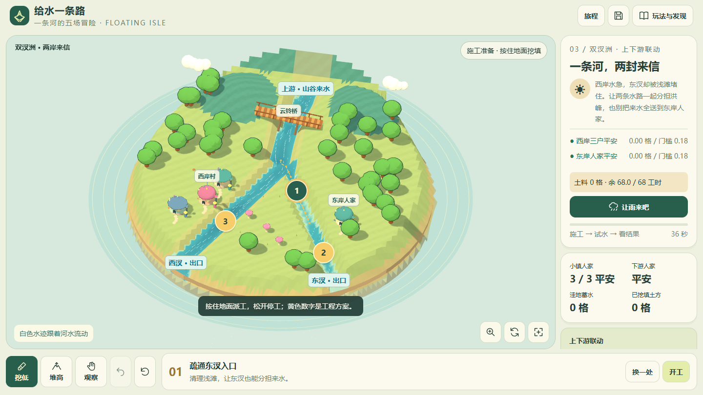
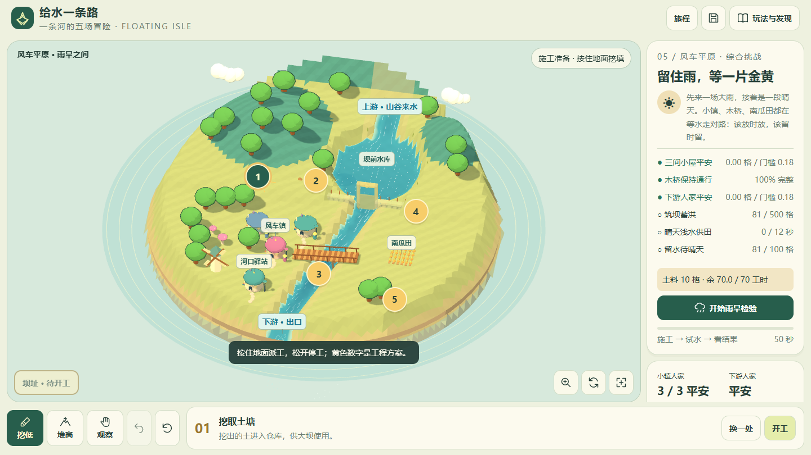

# Water Isle Simulation · 给水一条路

**简体中文** | [English](README.en.md)

[下载游戏 HTML](https://raw.githubusercontent.com/404-NOT-FOUND-ERROR/Water-Isle-Simulation/main/index.html) · [MIT License](LICENSE)

水利科普互动沙盒，包含五个渐进关卡与一张自由实验岛。游戏界面使用简体中文。

自包含互动 HTML，沿用 SandBox-Game 的浮岛、房屋、居民、树木、云朵和卡通材质。v6 以连续施工、独立地图和工程结果为核心，保留 v5 的浅水动力计算与 20 秒电影开场。

## 打开与构建

双击 `index.html`，或打开本地预览。Three.js、模型、代码、初始河流状态全部内联，约 3.1 MB。游戏与存档可离线运行，延伸阅读使用网络。

修改源码后执行 `node build.cjs`。构建阶段预计算每张地图的稳定初始河流；浏览器切换关卡时直接恢复完整的 Float64 水深与动量。

## 操作

- 长按地面召来施工员，到达岸边后持续施工；拖动换位置，松开立即停止。移出窗口、失焦、指针取消、打开弹窗也会停下手工施工。一整次长按是一笔撤销。
- 黄色数字选择工程，底部「开工」执行显示出的工程路线，再点「停工」保留已完成部分。手工施工时显示施工员到站位的路线。
- 挖土进入土料仓，填土和筑坝扣除土料。行走 20 格或挖填 18 格土消耗 1 工时。各关分别配置初始土料和总工时；耗尽后暂停施工。
- 「观察」可以拖动旋转，滚轮或放大按钮缩放，右下角回到全岛。
- 工程完成后检验来水。普通关卡观察整场雨，最后一关先暴雨再晴天。建坝后，检验中仍能通过「调闸」调整 0 / 25 / 50 / 75 / 100% 开度。
- 水位尺、桥况、库中水量、晴天供水和留水目标取自同一份模拟状态。结果逐项列出达成情况。

## 独立地图

| 站点 | 地貌与任务 | 主要工程 | 资源 |
| --- | --- | --- | --- |
| 云铃河谷 | 河道窄口旁的小镇；保护三间小屋 | 拓宽、分流、筑岸 | 自由挖填 |
| 青石峡 | 陡峭峡谷、桥下急流；小镇与木桥平安 | 绕桥旁路、桥下拓宽、护岸 | 65 工时，20 格土料 |
| 双汊洲 | 两条支流与中央洲滩；两岸共同平安 | 东汊入口、东汊出口、西汊拓宽 | 68 工时，0 格土料 |
| 月牙湖 | 宽谷与山口；筑坝、蓄水达到 700 格、护住下游 | 取土塘、带闸大坝、泄洪道 | 55 工时，10 格土料 |
| 风车平原 | 上游库区、下游木桥、侧边农田；同时满足六项目标 | 取土、筑坝、泄洪、田边供水渠和排水沟 | 70 工时，10 格土料 |
| 星屿 | 独立的蜿蜒河谷，自由实验 | 挖湖、改河、天气选择 | 自由挖填 |

最后一关要求：村庄与下游平安、桥保持通行、最高蓄水达到 500 格、晴天浅水供田累计 12 个模拟秒、田地水深始终低于 0.50 格，结束时库中留水至少 100 格。检验以四倍模拟速度播放。田地是综合工程中的一个约束。

## 水与工程

`sim.js` 在 81 × 81 网格上推进二维浅水方程，保存水深及两个方向的深度积分动量。HLL 有限体积通量、静水重构、Manning 底摩擦与 CFL 自适应子步共同计算水流。水量由入口注入、从岛缘流出；挖填保留水体体积。

`flow.js` 让示踪点沿实时速度场运动并保存轨迹，河道、分汊、蓄水区和新淹没区域均使用同一速度场。不同地图拥有自己的河床、入口方向、支流、库区、房屋与农田位置。

桥梁使用游戏尺度的冲刷耐久模型：读取桥上游局部水深和流速，以超出桥脚耐受值的水深 × 速度平方积累持续损伤。完整度下降时桥面变色、晃动，耗尽后中段塌落、通路中断。施工员的跨桥通路与桥况相连。各桥参数为关卡设计值。

大坝直接改变地形并消耗相应土方。闸门使用内部守恒的结构边界：根据开度、上下游水位差和闸孔尺寸，从上游单元取水、向下游单元输送同样体积并加入定向动量。闸口渲染出实际结构开口和与下泄同步的水流。闭闸停止闸孔输送；超过坝顶的水仍由地表求解器计算溢流。

物理资料：[Clawpack 浅水方程](https://www.clawpack.org/sphinx-versioning/riemann/Shallow_water_Riemann_solvers.html)、[Audusse 等人的静水重构](https://perso.math.u-pem.fr/bouchut.francois/publications/hydroproj.pdf)、[USACE 桥墩局部冲刷的影响因素](https://www.hec.usace.army.mil/confluence/rasdocs/ras1dtechref/6.5/estimating-scour-at-bridges/computing-local-scour-at-piers)。

## 存档与源码

v6 存档键为 `floating-isle-water-v6`，包含地形、水深、动量、土料、工时、桥况、坝与闸门、已做工程、旅程成绩。旧 v4 / v5 存档键保留。

- `shell.html`：界面、弹窗与响应式布局。
- `app.js`、`reused-art.js`：Three.js 场景与沿用的模型。
- `scenery.js`、`map-art.js`：桥、坝、关卡植被、建筑、施工反馈与农田。
- `camera.js`：连续开场与多比例镜头构图。
- `experience.js`：操作、施工、目标、检验、反馈和存档。
- `sim.js`、`hydraulics.js`：水体、桥损伤和闸门边界。
- `campaign.js`、`construction.js`：独立地形、工程、目标与施工寻路。

## 验证

- `node test-physics.cjs`：静水、惯性、阻水与缺口、水量守恒。
- `node test-crew.cjs`：持续长按、拖动重定向、停止、资源限额与恢复。
- `node test-hydraulics.cjs`：持续冲刷、桥断裂、闸门开闭、定向下泄和体积守恒。
- `node test-campaign-v6.cjs`：四张施工队地图全部工程、实际寻路和资源消耗，及完整来水下全部目标通过。

浏览器验证包括完整电影开场、真实流迹、长按与取消停工、撤销、筑坝调闸、保存读取和完整雨旱关卡。尺寸覆盖 1440×810、1024×768、768×1024、352×447、390×753 与 844×390；以上为浏览器尺寸模拟。

## 游戏画面

原作：[SandBox-Game](https://github.com/404-NOT-FOUND-ERROR/SandBox-Game)。MIT 许可保存在 `LICENSE-original`，Three.js 版权见 `THIRD-PARTY-NOTICES.txt`。
